# Démo — MedievAIl Battle

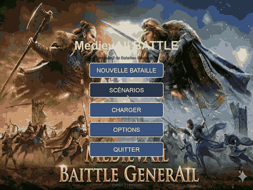

> Aperçu accéléré x3. **[Vidéo complète : `demo.mp4`](demo.mp4)** (55 s, 1024×768, 30 images/s).

## Ce que montre la démo

Parcours complet du jeu, du menu à la victoire :

1. **Menu principal** → *Nouvelle bataille*.
2. **Configuration** : IA de l'équipe A = *General STRATEGUS*, IA de l'équipe B = *Major DAFT*, composition *Grande Bataille (105 unités par équipe)*, terrain *Colline Centrale*.
3. **Bataille** : 210 unités (piquiers, chevaliers, arbalétriers), zoom à la molette, déplacement de la caméra au glisser-déposer, minimap (`M`).
4. **Fin de partie** : *Victoire équipe B* (87 survivants contre 0), puis retour au menu avec `ÉCHAP`.

## Captures d'écran

| | |
| :-- | :-- |
| 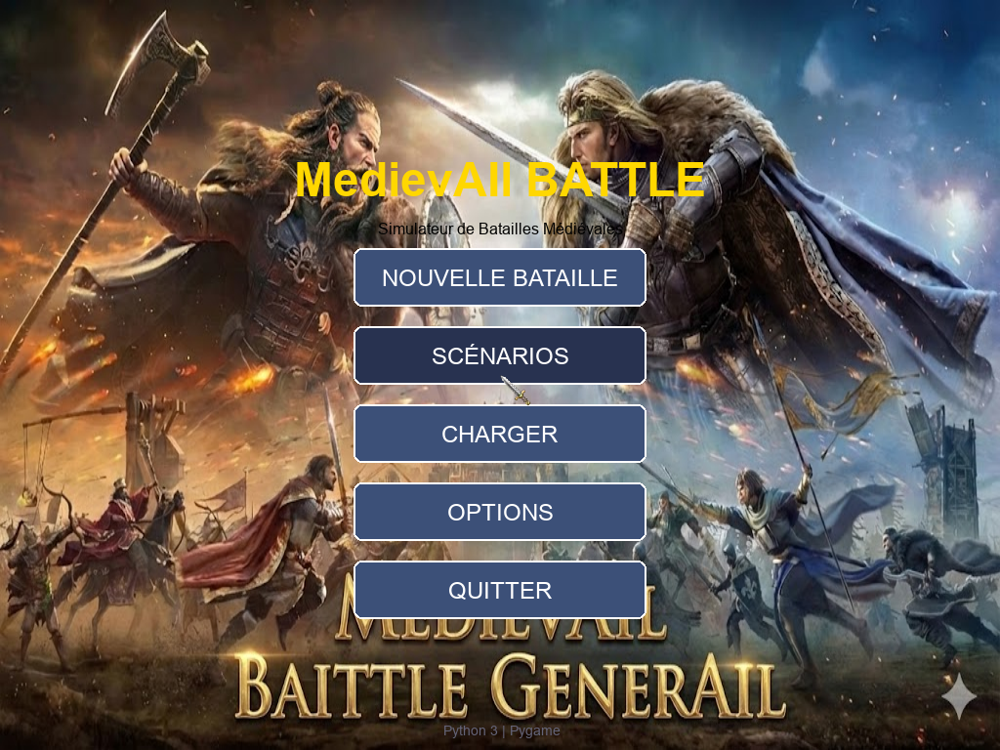<br>**01** Menu principal | 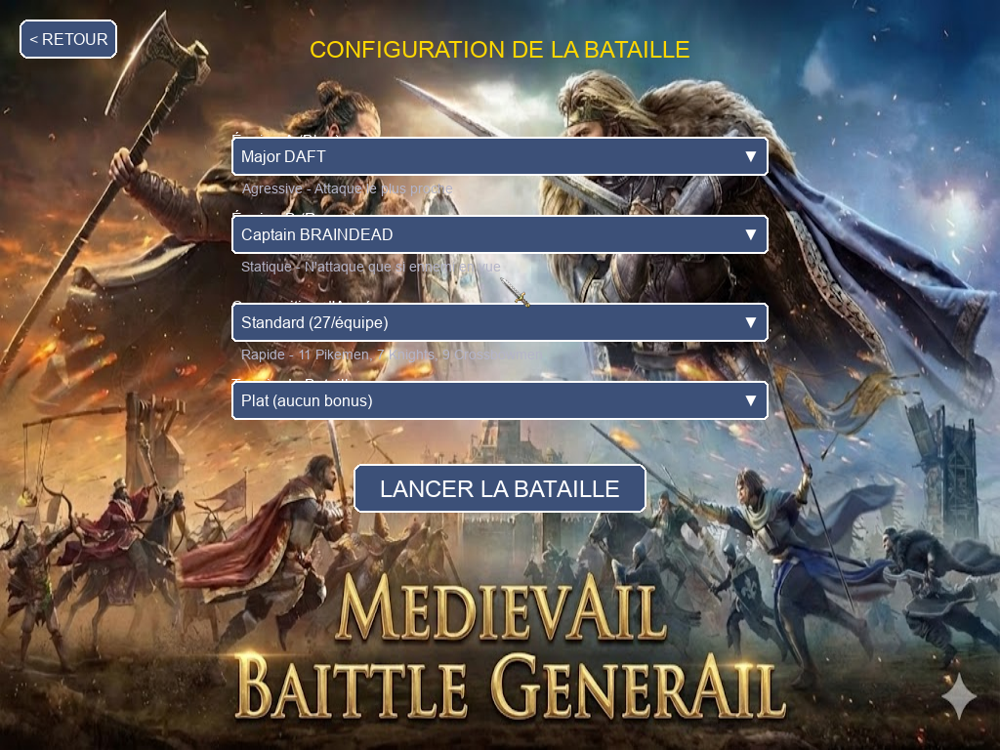<br>**02** Configuration de la bataille |
| 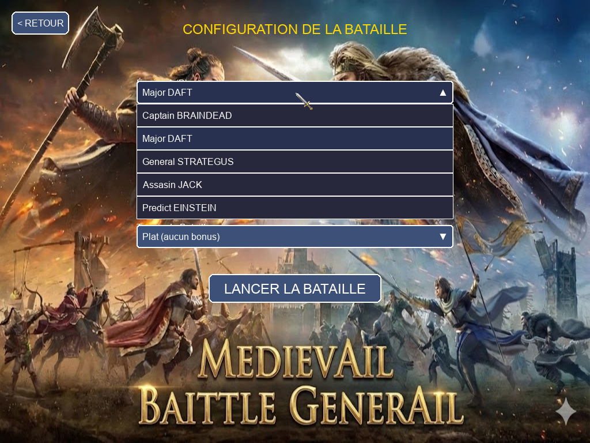<br>**03** Choix de l'IA | 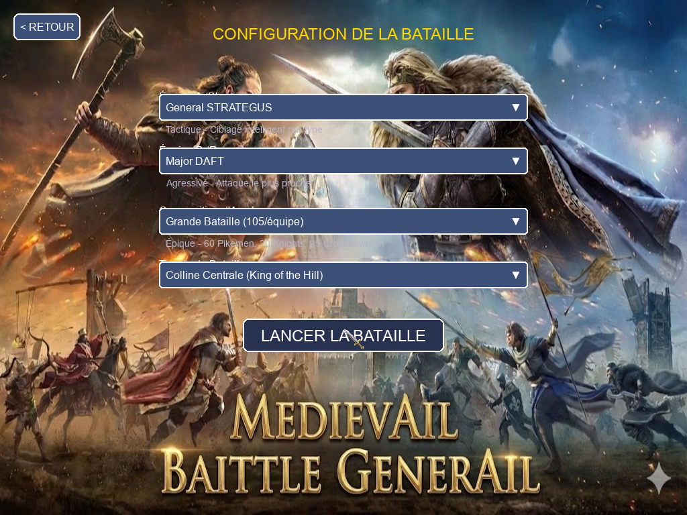<br>**04** Configuration complète |
| 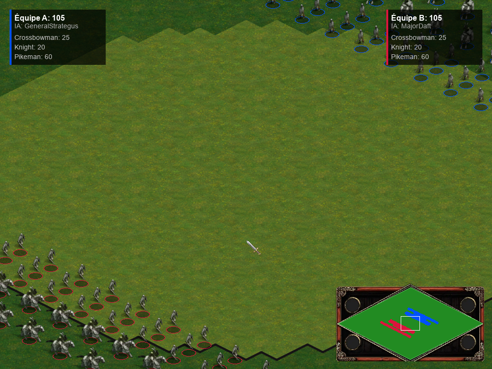<br>**05** Début de bataille | 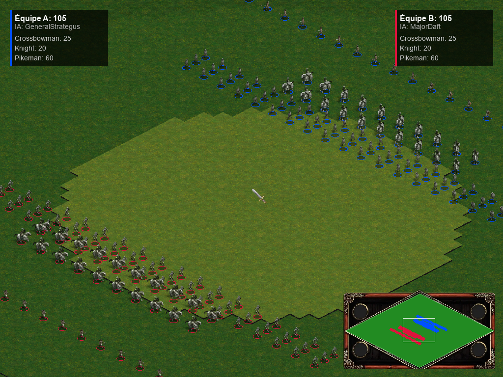<br>**06** Vue d'ensemble (dézoom) |
| 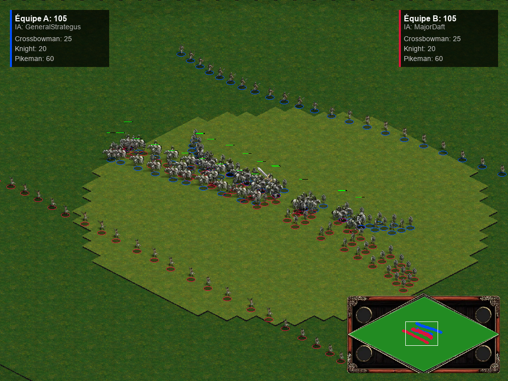<br>**07** Les deux armées se rejoignent | 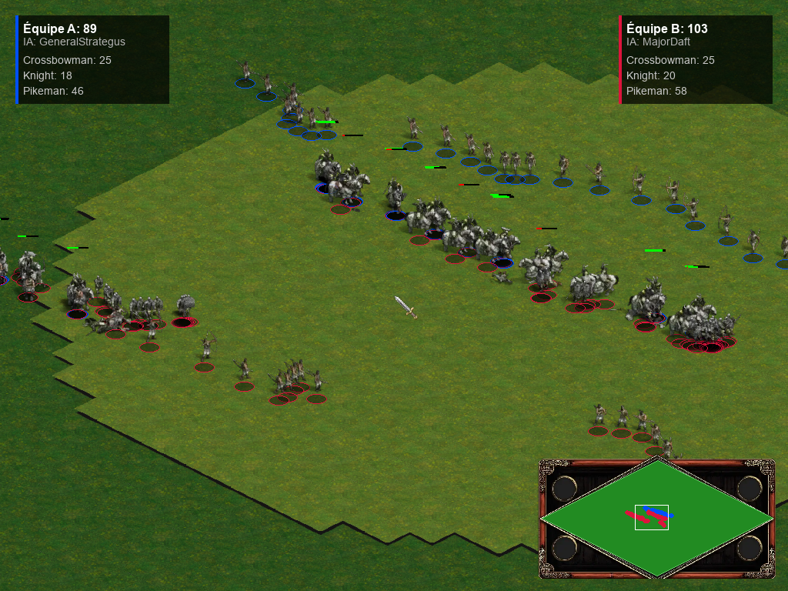<br>**08** Zoom sur la mêlée |
| 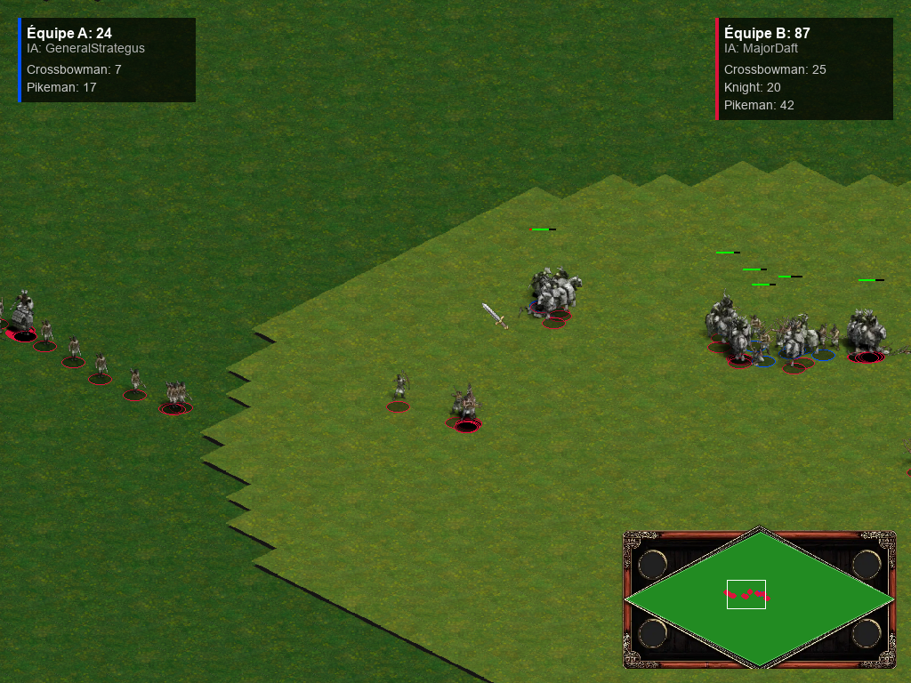<br>**09** Bataille en cours | 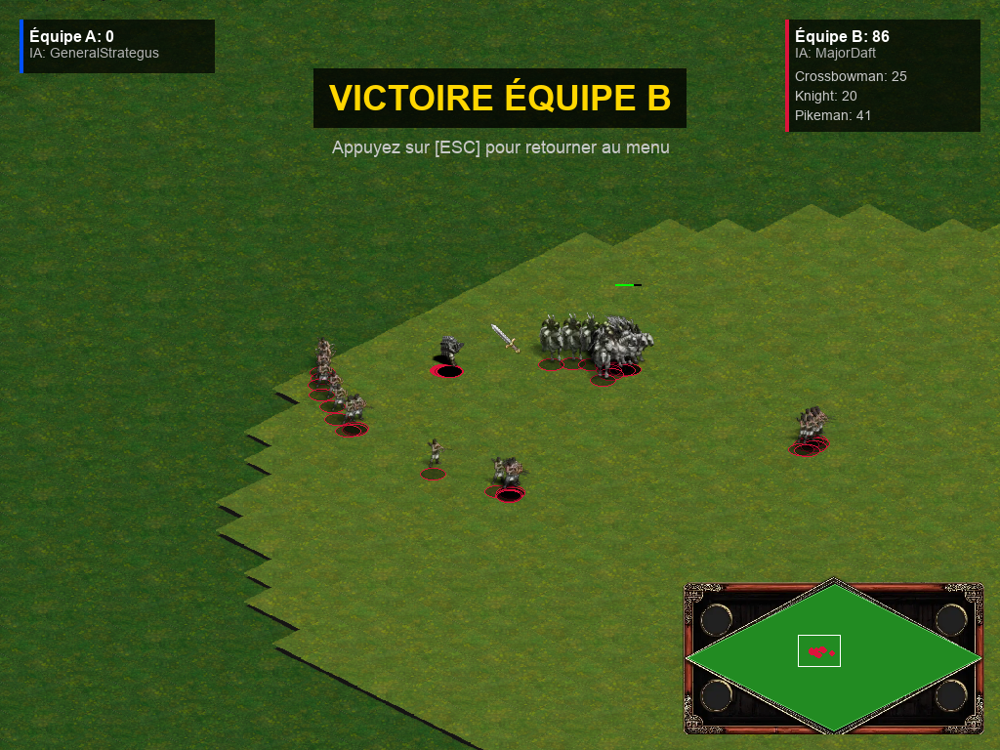<br>**10** Victoire |
| <br>**11** Retour au menu | |

## Comment la démo a été réalisée

[`capture_demo.py`](capture_demo.py) exécute **le vrai jeu** (`view/menu.py` en mode fenêtré, puis la bataille), sans modifier son code. Seuls la souris, le clavier et l'horloge sont pilotés par un scénario scripté, et l'affichage utilise le pilote SDL `dummy` (aucune fenêtre ne s'ouvre). Chaque image réellement dessinée par le jeu est enregistrée à 30 images/s en temps virtuel : la vidéo est donc fluide quelle que soit la machine, et le résultat est reproductible.

Pour régénérer la vidéo, le GIF et les captures (depuis la racine du dépôt) :

```bash
pip install pygame   # ffmpeg doit être installé et accessible dans le PATH
python demo/capture_demo.py
```
